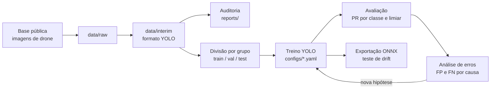

<p align="center">
  
</p>

<h1 align="center">Inspeção de Isoladores por Visão Computacional</h1>

<p align="center">
  <b>Detecção de isoladores e de defeitos em imagens de drone de linhas de transmissão, construída fase a fase</b><br>
  Definição do problema · auditoria de dados · divisão sem vazamento · YOLO · análise de erros · drift
</p>

<p align="center">
  
  
  
  
  
  
</p>

---

Projeto educativo e independente. O objetivo não é bater recorde de métrica: é percorrer o ciclo completo de um modelo de visão computacional em produção, entendendo cada decisão, e registrar o caminho em commits e tags. Usa apenas dados públicos.

## O que o projeto cobre

| Fase | Entrega | Conceito central | Status |
|---|---|---|---|
| 0. Ambiente | Repositório e ambiente reproduzível | Ferramentas e reprodutibilidade | concluída |
| 1. Problema | Classes, custo do erro e meta de precision | A métrica é decisão de negócio | pendente |
| 2. Auditoria | Diagnóstico das imagens e das anotações | Dado ruim limita qualquer modelo | pendente |
| 3. Divisão | Treino, validação e teste por grupo | Vazamento infla a métrica | pendente |
| 4. Baseline | YOLO pequeno pré-treinado ajustado | Transfer learning | pendente |
| 5. Avaliação | Precision e recall por classe, limiar por classe | O mAP sozinho engana | pendente |
| 6. Erros | Galeria de FP e FN agrupada por causa | O erro mostra o que melhorar | pendente |
| 7. Melhorias | Tiling, augmentation e peso por classe | Desbalanceamento e objeto pequeno | pendente |
| 8. Produção | Exportação, teste de drift e monitoramento | O modelo degrada fora do laboratório | pendente |

Cada fase termina com a tag correspondente (`v0.0-ambiente`, `v0.1-problema` e assim por diante), para que o estado do projeto em qualquer etapa possa ser recuperado.

## Pipeline



| Etapa | Módulo | O que faz |
|---|---|---|
| Dados | `src/data/` | Download, conversão de anotações e auditoria |
| Divisão | `src/split/` | Split por grupo e teste de vazamento |
| Treino | `src/train/` | Treino a partir de um YAML por experimento |
| Avaliação | `src/evaluate/` | Métricas por classe, curva PR e limiar por classe |
| Análise | `src/analyze/` | Galeria de erros e agrupamento por causa |
| Produção | `src/deploy/` | Exportação e medição sob perturbação |

Detalhes e decisões de arquitetura em [`docs/ARQUITETURA.md`](docs/ARQUITETURA.md).

## Como rodar (Windows / PowerShell)

```powershell
git clone https://github.com/candidoea/cv-inspecao-isoladores.git
cd cv-inspecao-isoladores

python -m venv .venv
.venv\Scripts\activate
python -m pip install -r requirements.txt
yolo checks
```

Os comandos de cada fase entram aqui à medida que as fases forem concluídas.

## Estrutura

```
cv-inspecao-isoladores/
├── assets/          identidade visual do repositório
├── configs/         um YAML por experimento
├── docs/            arquitetura e notas técnicas
├── notebooks/       exploração e visualização
├── src/             data, split, train, evaluate, analyze, deploy
├── reports/         tabelas e figuras leves de cada fase
├── data/            imagens e anotações (fora do Git)
├── runs/            saídas de treino (fora do Git)
└── models/          pesos exportados (fora do Git)
```

## Decisões

Preenchidas na Fase 1.

| Decisão | Valor | Justificativa |
|---|---|---|
| Classes | | |
| Erro mais caro | | |
| Meta de precision para `defeito` | | |
| Métrica principal | | |

## Princípios

- **A métrica vem do problema.** Perder um defeito custa mais que validar um alarme falso, e a métrica principal reflete isso.
- **Nada de vazamento.** Imagens da mesma estrutura ou do mesmo voo ficam sempre no mesmo conjunto.
- **Por classe, nunca só global.** Uma média esconde a classe rara.
- **Todo experimento é reproduzível.** Configuração versionada, semente fixa e commit registrado em cada execução.
- **Erros são documentados.** Melhorias que não funcionaram também entram no relatório.

## Dados

Somente bases públicas de imagens de isoladores. Imagens, anotações e pesos não fazem parte do repositório; a origem, a licença e a versão usadas ficam registradas aqui na Fase 2.

## Autoria

**Eduardo Cândido**, Cientista de Dados. Projeto educativo com dados públicos, outubro de 2026.
