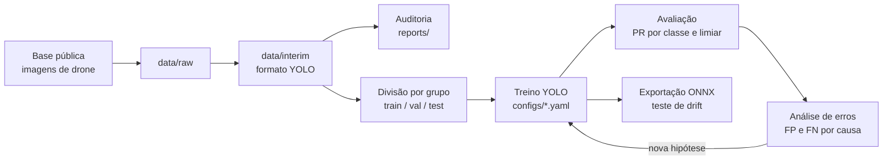

<p align="center">
  
</p>

<h1 align="center">Inspeção de Isoladores por Visão Computacional</h1>

<p align="center">
  <b>Detecção de isoladores e de defeitos em imagens de drone de linhas de transmissão, construída fase a fase</b><br>
  Definição do problema · auditoria de dados · divisão sem vazamento · YOLO · análise de erros · drift
</p>

<p align="center">
  
  
  
  
  
  
</p>

---

Projeto educativo e independente. O objetivo não é bater recorde de métrica: é percorrer o ciclo completo de um modelo de visão computacional em produção, entendendo cada decisão, e registrar o caminho em commits e tags. Usa apenas dados públicos.

## O que o projeto cobre

| Fase | Entrega | Conceito central | Status |
|---|---|---|---|
| 0. Ambiente | Repositório e ambiente reproduzível | Ferramentas e reprodutibilidade | concluída |
| 1. Problema | Classes, custo do erro e meta de precision | A métrica é decisão de negócio | concluída |
| 2. Auditoria | Diagnóstico das imagens e das anotações | Dado ruim limita qualquer modelo | concluída |
| 3. Divisão | Treino, validação e teste por grupo | Vazamento infla a métrica | concluída |
| 4. Baseline | YOLO pequeno pré-treinado ajustado | Transfer learning | concluída |
| 5. Avaliação | Precision e recall por classe, limiar por classe | O mAP sozinho engana | pendente |
| 6. Erros | Galeria de FP e FN agrupada por causa | O erro mostra o que melhorar | pendente |
| 7. Melhorias | Tiling, augmentation e peso por classe | Desbalanceamento e objeto pequeno | pendente |
| 8. Produção | Exportação, teste de drift e monitoramento | O modelo degrada fora do laboratório | pendente |

Cada fase termina com a tag correspondente (`v0.0-ambiente`, `v0.1-problema` e assim por diante), para que o estado do projeto em qualquer etapa possa ser recuperado.

## Pipeline



| Etapa | Módulo | O que faz |
|---|---|---|
| Dados | `src/data/` | Download, conversão de anotações e auditoria |
| Divisão | `src/split/` | Embeddings, grupos de imagens parecidas e divisão estratificada |
| Treino | `src/train/` | Treino a partir de um YAML por experimento |
| Avaliação | `src/evaluate/` | Métricas por classe, curva PR e limiar por classe |
| Análise | `src/analyze/` | Galeria de erros e agrupamento por causa |
| Produção | `src/deploy/` | Exportação e medição sob perturbação |

Detalhes e decisões de arquitetura em [`docs/ARQUITETURA.md`](docs/ARQUITETURA.md).

## Como rodar (Windows / PowerShell)

```powershell
git clone https://github.com/candidoea/cv-inspecao-isoladores.git
cd cv-inspecao-isoladores

python -m venv .venv
.venv\Scripts\activate
python -m pip install -r requirements.txt
yolo checks
```

Fase 2, auditoria dos dados (a base precisa estar em `data/raw/cplid`, ver seção Dados):

```powershell
git clone --depth 1 https://github.com/InsulatorData/InsulatorDataSet.git data/raw/cplid
python src/data/inventario.py           # tabela de anotações
python src/data/estatisticas_imagem.py  # brilho, nitidez, tamanho e hash por imagem
python src/data/quase_duplicatas.py     # duplicatas e sequência
python src/data/converter.py            # conversão para YOLO em data/interim
```

A análise completa, com perguntas, hipóteses e gráficos, está em `notebooks/02_auditoria.ipynb`.

Fase 3, divisão em treino, validação e teste por grupo de imagens parecidas:

```powershell
python src/split/similaridade.py   # embeddings (ResNet18) e similaridade entre imagens
python src/split/grupos.py         # grupos de imagens da mesma cena
python src/split/dividir.py        # divisão estratificada por origem, sem dividir grupos
```

A divisão usada no projeto está registrada em `configs/split.csv`. Detalhes em [`reports/fase3/divisao.md`](reports/fase3/divisao.md).

Fase 4, baseline. O treino roda no Google Colab com GPU, porque em CPU cada época leva cerca de 7 minutos. O passo a passo, do upload dos dados ao treino, está em `notebooks/04_treino_colab.ipynb`:

```bash
python src/train/treinar.py configs/exp01_baseline.yaml
```

Cada execução grava em `runs/<nome>/registro.json` a configuração, o commit e o ambiente. Resultados e leitura em [`reports/fase4/baseline.md`](reports/fase4/baseline.md).

Os comandos das próximas fases entram aqui à medida que forem concluídas.

## Estrutura

```
cv-inspecao-isoladores/
├── assets/          identidade visual do repositório
├── configs/         um YAML por experimento
├── docs/            arquitetura e notas técnicas
├── notebooks/       exploração e visualização
├── src/             data, split, train, evaluate, analyze, deploy
├── reports/         tabelas e figuras leves de cada fase
├── data/            imagens e anotações (fora do Git)
├── runs/            saídas de treino (fora do Git)
└── models/          pesos exportados (fora do Git)
```

## Decisões

Preenchidas na Fase 1.

| Decisão | Valor | Justificativa |
|---|---|---|
| Classes | `isolador` e `defeito` | O isolador dá contexto de localização, separa erro de localização de erro de diagnóstico e permite um pipeline em dois estágios na Fase 7 |
| Erro mais caro | FN de `defeito` | Um defeito não detectado pode causar falha na linha; um alarme falso custa segundos de revisão. Premissa de 10 a 20x, conservadora, com análise de sensibilidade na Fase 5 |
| Unidade de avaliação | Caixa e imagem | Por imagem, porque o inspetor revisa imagens; por caixa, para não esconder defeitos perdidos em imagens com mais de um defeito. FP por imagem mede a carga de revisão |
| Meta | Recall de `defeito` por imagem ≥ 0,95 (restrição); maximizar precision, com piso de 0,50 | O recall é inegociável pelo custo assimétrico; se o piso de precision não for atingível com o recall exigido, o piso é revisto e registrado |
| Métrica de comparação | mAP@0.5 e mAP@0.5:0.95 | Só para comparar experimentos; a decisão de operação usa o ponto da curva definido acima |

## Princípios

- **A métrica vem do problema.** Perder um defeito custa mais que validar um alarme falso, e a métrica principal reflete isso.
- **Nada de vazamento.** Imagens da mesma estrutura ou do mesmo voo ficam sempre no mesmo conjunto.
- **Por classe, nunca só global.** Uma média esconde a classe rara.
- **Todo experimento é reproduzível.** Configuração versionada, semente fixa e commit registrado em cada execução.
- **Erros são documentados.** Melhorias que não funcionaram também entram no relatório.

## Dados

| Item | Valor |
|---|---|
| Base | CPLID, Chinese Power Line Insulator Dataset |
| Origem | https://github.com/InsulatorData/InsulatorDataSet |
| Versão | commit `1f6349f619237344d49905090ecf2704505394a4` (19/11/2018) |
| Licença | Sem licença explícita; uso educativo, sem redistribuição das imagens |
| Observação | Segundo a descrição da base, as imagens normais foram capturadas por drone e as imagens com defeito são sintéticas |

Imagens, anotações e pesos não fazem parte deste repositório.

**Limitação principal:** as imagens com defeito são composições sintéticas e diferem das normais em nitidez, compressão e brilho. O tamanho do arquivo sozinho separa as duas origens. Detalhes e os 13 achados da auditoria em [`reports/fase2/auditoria.md`](reports/fase2/auditoria.md).

## Autoria

**Eduardo Cândido**, Cientista de Dados. Projeto educativo com dados públicos, outubro de 2026.
