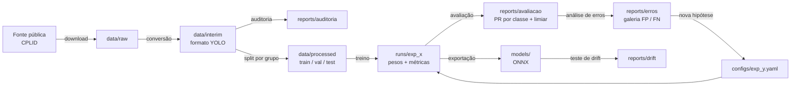

# Arquitetura do projeto

## 1. Visão geral

O projeto é um pipeline em etapas independentes. Cada etapa lê artefatos da anterior e grava os seus em disco. Assim qualquer etapa pode ser refeita sozinha, e cada resultado aponta para a configuração e o commit que o produziram.



## 2. Estrutura de pastas

```
cv-inspecao-isoladores/
├── README.md
├── requirements.txt
├── .gitignore
├── configs/                 configuração de cada experimento (YAML)
├── data/                    fora do Git
│   ├── raw/                 dados como vieram da fonte
│   ├── interim/             convertidos para o formato YOLO
│   └── processed/           divisão final train / val / test
├── docs/
│   ├── SPEC.md              especificação
│   ├── ARQUITETURA.md       este documento
│   └── DIARIO.md            o que foi feito e aprendido em cada fase
├── notebooks/               exploração e visualização
├── src/
│   ├── data/                download, conversão, auditoria
│   ├── split/               divisão por grupo e teste de vazamento
│   ├── train/               treino a partir de um YAML
│   ├── evaluate/            métricas por classe, curva PR, limiar
│   ├── analyze/             galeria de erros e agrupamento por causa
│   └── deploy/              exportação e teste de drift
├── reports/                 saídas leves versionadas (CSV, PNG, MD)
├── runs/                    saídas do treino, fora do Git
└── models/                  pesos exportados, fora do Git
```

## 3. Componentes

| Módulo | Entrada | Saída | Fase |
|---|---|---|---|
| `src/data` | URL da fonte | `data/raw`, `data/interim`, relatório de auditoria | 2 |
| `src/split` | `data/interim` | `data/processed` + `split.csv` com o grupo de cada imagem | 3 |
| `src/train` | `configs/*.yaml` + `data/processed` | `runs/<exp>` (pesos, métricas, configuração copiada) | 4 e 7 |
| `src/evaluate` | pesos + conjunto | métricas por classe, curva PR, limiar por classe | 5 |
| `src/analyze` | predições + rótulos | imagens de FP e FN, tabela de causas | 6 |
| `src/deploy` | pesos | modelo ONNX, métricas sob perturbação | 8 |

Você escreve o código de cada módulo na fase correspondente. A pasta existe desde o início para a estrutura ficar clara.

## 4. Decisões de arquitetura

| # | Decisão | Alternativa descartada | Motivo |
|---|---|---|---|
| D1 | YOLO da Ultralytics como detector | Faster R-CNN, DETR | Treino simples, bom com poucos dados, documentação ampla; o foco é o ciclo, não o modelo |
| D2 | FiftyOne para inspecionar dados e erros | Só matplotlib | Navegar por milhares de caixas e filtrar FP/FN é muito mais rápido |
| D3 | Split por grupo (voo, torre ou cluster visual) | Split aleatório por imagem | Imagens quase iguais em treino e teste inflam a métrica |
| D4 | Configuração em YAML, um arquivo por experimento | Parâmetros no código | Experimento reproduzível e comparável |
| D5 | Dados e pesos fora do Git | Git LFS | Repositório público e leve; licença dos dados respeitada |
| D6 | Limiar escolhido por classe na validação | Limiar padrão 0,25 para tudo | O custo do erro é diferente por classe |

## 5. Rastreabilidade

Cada execução de treino grava em `runs/<exp>/`:

- a cópia do YAML usado;
- o hash do commit (`git rev-parse HEAD`);
- as métricas finais em CSV.

O `reports/` guarda só o que é leve e explica o resultado (tabelas e gráficos). O `docs/DIARIO.md` registra, por fase, o que foi feito, o que deu errado e o que foi aprendido.

## 6. Fluxo de Git

- Branch `main` sempre estável.
- Ao fim de cada fase: commit com a mensagem `fase N: <resumo>` e tag da fase (ver SPEC, seção 7).
- Antes de cada push: conferir com `git status` que nada de `data/`, `runs/` ou `models/` entrou no commit.
