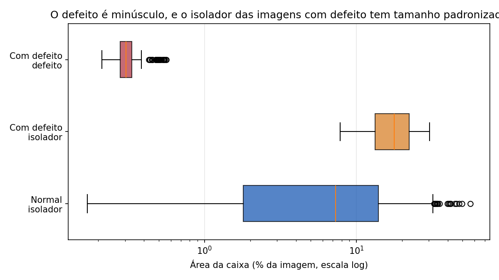
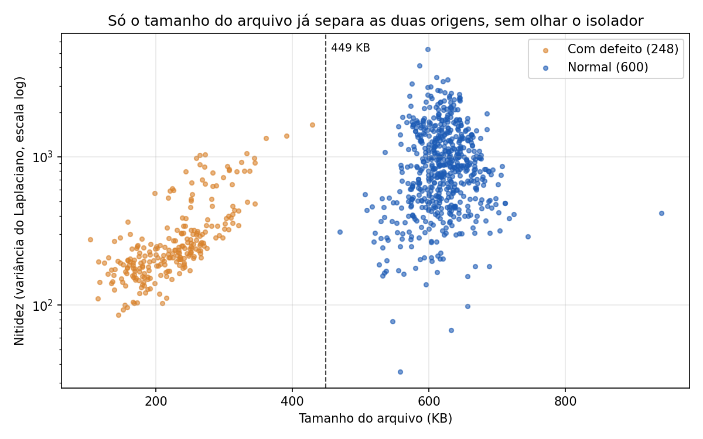

# Fase 2. Auditoria dos dados

**Base:** CPLID, commit `1f6349f` (ver README, seção Dados)
**Código:** `notebooks/02_auditoria.ipynb` e `src/data/`

## Resumo

A base tem 848 imagens: 600 fotos reais de drone sem defeito e 248 imagens com defeito. A auditoria mostrou que **as imagens com defeito são composições sintéticas** (isolador recortado e colado sobre outra foto) e que elas diferem das normais em características que não têm relação com o defeito. A mais forte: **o tamanho do arquivo separa as duas origens em 100% dos casos**. Um modelo treinado nesta base pode obter métricas altas aprendendo essas diferenças em vez do defeito. Esta é a limitação principal do projeto, e os controles estão planejados para as Fases 5 e 7.

Depois da limpeza, a base usada nas fases seguintes tem **845 imagens** (3 duplicatas removidas), com **1.318 isoladores** e **248 defeitos**.

## Achados

| # | Achado | Evidência | Tratamento |
|---|---|---|---|
| 1 | Desbalanceamento moderado | 248 defeitos em 1.569 caixas (16%); 248 de 848 imagens (29%) | Fase 7: balanceamento |
| 2 | Defeitos muito pequenos | Mediana de 0,31% da área da imagem, cerca de 30 px de lado com imagem de 640 px | Fase 7: tamanho de imagem e tiling |
| 3 | Estrutura fixa nas imagens com defeito | Sempre 1 isolador + 1 defeito; isolador com ~18% da imagem e pouca variação (normais: 0,2% a 56%) | Atalho: controles nas Fases 5 e 7 |
| 4 | Coordenadas válidas | 0 caixas inválidas em 1.569 | Nada a fazer |
| 5 | Dois arquivos de anotação por imagem com defeito | 496 XML para 248 imagens (`labels/defect` e `labels/insulator`) | Conversão junta os dois pelo nome da imagem |
| 6 | Resolução igual nas duas origens | Todas com 1152 × 864 | Descartada como atalho |
| 6b | **Nitidez e compressão separam as origens** | Nitidez mediana 228 contra 854; arquivo 226 KB contra 618 KB; maior imagem com defeito (429 KB) menor que a menor normal (469 KB) | **Limitação principal**: teste contrafactual (Fase 5) e augmentation de borrão e compressão (Fase 7) |
| 7 | Imagens duplicadas | 3 pares idênticos entre as normais (`0150`/`2984`, `0852`/`1876`, `1608`/`1938`) | Uma cópia de cada removida |
| 8 | Brilho diferente | Mediana 153 (com defeito) contra 130 (normal) | Mais uma dimensão do atalho |
| 9 | Sem quase duplicatas pelo hash perceptual | Nenhum par adicional com distância de Hamming ≤ 8 | Recortes da mesma foto não são detectáveis por hash: verificação por embeddings na Fase 3 |
| 10 | Nome do arquivo não indica sequência de voo | Distância mediana entre vizinhos 30, entre pares aleatórios 32; nenhum vizinho ≤ 16 | Sem grupo natural para a divisão |
| 11 | Campo `filename` do XML sem extensão | `000`, `0049`; lido como número, perde zeros à esquerda | Nome tirado do arquivo XML; leitura com `dtype=str` |
| 12 | Anotações incompletas | Isoladores cortados na borda às vezes sem caixa, às vezes com caixa | Fase 6: separar falsos FP na análise de erros |
| 13 | Imagens com defeito são colagens | Contorno visível em volta do isolador colado; isolador às vezes solto da torre | Agrava o atalho: o modelo pode aprender a borda da colagem |

## Figuras

*O defeito ocupa uma fração mínima da imagem, e o isolador das imagens com defeito tem tamanho padronizado, ao contrário das fotos reais.*

*As duas origens não se sobrepõem no tamanho do arquivo: uma regra trivial distingue as imagens com defeito sem olhar para o isolador.*

## Como a hipótese evoluiu

A primeira explicação para as diferenças entre as origens foi "recorte ampliado de fotos maiores", compatível com a nitidez baixa e o arquivo leve. A inspeção visual mostrou que a explicação correta é a **colagem**: o isolador recortado é nítido, mas o fundo enevoado ocupa a maior parte da imagem e puxa a nitidez média para baixo. Os números indicaram que havia diferença; a inspeção mostrou qual era.

## Consequências para as próximas fases

| Fase | O que muda |
|---|---|
| 3. Divisão | Usar as 845 imagens limpas; estratificar por origem; testar vazamento de recortes por embeddings |
| 5. Avaliação | Teste contrafactual: degradar imagens normais (borrão e compressão) e medir se o modelo passa a apontar defeitos nelas |
| 6. Erros | Separar FP causados por anotação faltando |
| 7. Melhorias | Augmentation de borrão e compressão em todas as imagens; tamanho de imagem e tiling para os defeitos pequenos |
